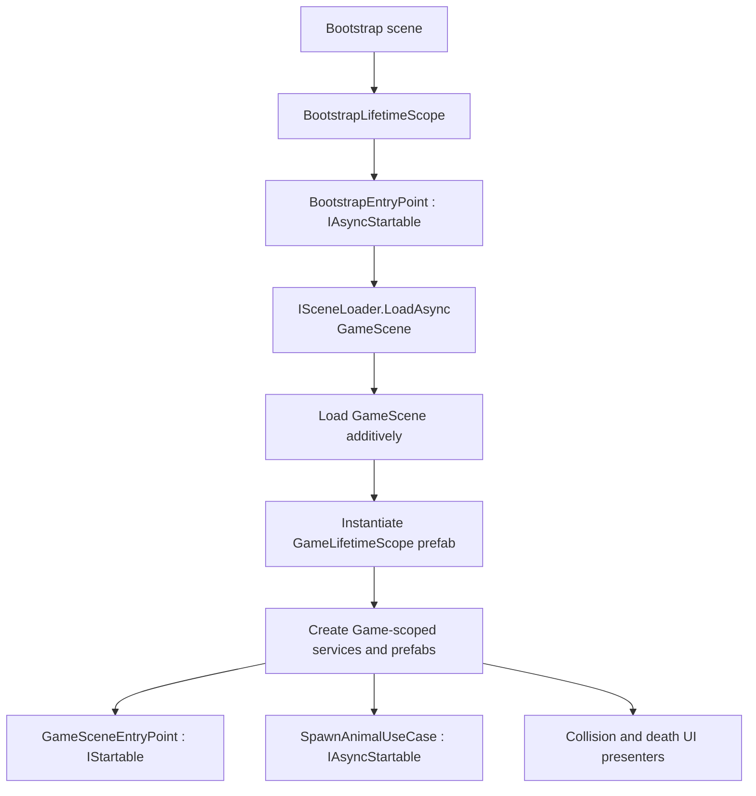

# Zoo World

A small top-down 3D animal simulation built in **Unity** as a technical assessment. Animals spawn periodically, roam around the visible play area, interact through Unity physics, and follow a simple predator–prey food chain.

The emphasis is on **readable, extensible animal architecture**, not visual fidelity. The project uses composition and configurable movement strategies rather than a class hierarchy for every species. **ECS is not used.**

## Features

- Configurable random animal spawning (default interval: **1–2 seconds**).
- Random movement direction with automatic steering back toward the camera's visible area.
- **Jump movement** for frogs, using Rigidbody physics and a ground check.
- **Linear movement** for snakes, using a target velocity and acceleration.
- Physical collisions between animals.
- Predator–prey rules:
  - **Prey + prey:** no kill; physics handles the contact.
  - **Predator + prey:** the prey dies.
  - **Predator + predator:** one survives, determined by instance ID ordering.
- A **“Tasty!”** UI label displayed after a successful kill.
- Separate UI counters for dead prey and dead predators.
- Additive scene loading and scene-specific dependency scopes.

## Technology

- **Unity 6** (the movement code uses `Rigidbody.linearVelocity`; the exact editor version is not included in the supplied scripts)
- **C#**
- **VContainer** — dependency injection, lifetime scopes, and entry points
- **UniTask** — asynchronous loading, spawning, and timed UI effects
- **ScriptableObject** — scene, species, movement, and spawn configurations
- **Unity Physics** — Rigidbody and Collider
- **uGUI / TextMeshPro** — counters and feedback labels

## Entry point and startup

> **Start the application from the `Bootstrap` scene.** The gameplay scene is named **`GameScene`** in `SceneNames.cs` and is intentionally empty in the editor.



### Bootstrap scope

`Scripts/Bootstrap/BootstrapLifetimeScope.cs` registers:

- `IScenesRepository` — a ScriptableObject-backed map from scene name to lifetime-scope prefab.
- `ISceneLoader` / `SceneLoader` — additive scene loading, unloading, and switching.
- `IRandomSource` / `UnityRandomSource` — random number generation.
- `BootstrapEntryPoint` — starts the application by loading `SceneNames.Game` (`"GameScene"`).

`SceneLoader` serializes scene transitions with a `SemaphoreSlim`. After loading a scene, it instantiates the configured `LifetimeScope` prefab and connects it to the Bootstrap scope with `LifetimeScope.EnqueueParent(...)`.

### Game scope

`Scripts/Bootstrap/GameLifetimeScope.cs` is attached to a **prefab**, not placed directly in `GameScene`. It registers the gameplay dependencies and creates the following scoped prefab roots:

- `GameWorldRoot` — provides the **camera** and `AnimalsRoot` transform.
- `GameUIRoot` — provides the **Canvas**, death counter view, floating-label root, and “Tasty!” label prefab.

It also registers the animal factory, spawn-position provider, collision use case, death statistics, and presenters. Its VContainer entry points include:

| Entry point | Responsibility |
| --- | --- |
| `GameSceneEntryPoint` (`IStartable`) | Initializes the UI with the game camera. |
| `SpawnAnimalUseCase` (`IAsyncStartable`) | Runs the timed spawning loop with UniTask. |
| `AnimalCollisionPresenter` (`IStartable`, `IDisposable`) | Subscribes to new collision controllers and handles their events. |
| `DeathCounterPresenter` (`IStartable`, `IDisposable`) | Subscribes to death statistics and updates the UI. |

Unloading `GameScene` also destroys its scene objects and disposes the game-scoped lifetime.

## Architecture

The code is organized by responsibility, with domain rules kept separate from Unity presentation code:

```text
Scripts/
├── Bootstrap/               # LifetimeScopes and application/scene entry points
├── Domain/
│   ├── Interfaces/          # IAnimal, IMortal, IDeathList
│   └── Models/
│       ├── Animals/         # Animal, AnimalId, AnimalType, AnimalsDeathList
│       └── Interactions/    # AnimalInteractionPolicy, AnimalCollisionResult
├── UseCases/Animals/        # SpawnAnimalUseCase, ResolveAnimalsCollisionUseCase
├── Repositories/
│   ├── Animals/             # AnimalRepository, AnimalsCatalog, spawn settings
│   ├── Movement/            # MovementConfig, JumpMovementConfig, LinearMovementConfig
│   └── ScenesManagement/    # ScenesRepository
├── Infrastructure/
│   ├── SceneManagement/     # SceneLoader, ISceneLoader, SceneNames
│   ├── Factories/Animals/   # AnimalFactory
│   ├── Spawning/            # CameraSpawningPositionProvider
│   ├── Movement/            # IMovementBehaviour and implementations
│   ├── Directions/          # RandomWanderDirection, ScreenBoundsDirection
│   └── Random/              # IRandomSource, UnityRandomSource
├── Presentation/
│   ├── Controllers/Animals/ # Movement and collision controllers
│   ├── Presenters/          # Collision, death counter, Tasty! UI
│   └── Views/               # Animal, collision decorator and UI views
└── Roots/                   # GameWorldRoot and GameUIRoot
```

### Animal composition

An animal is assembled from several independent pieces:

| Component | Responsibility |
| --- | --- |
| `Animal` / `IAnimal` | Species ID, unique instance ID, type, and alive/dead state. |
| `AnimalView` | Unity representation and initialization of the domain model. |
| `AnimalMovementController` | Executes a per-animal movement strategy in `FixedUpdate`. |
| `IMovementBehaviour` | Defines *how* an animal moves (`JumpMovement`, `LinearMovement`). |
| `RandomWanderDirection` | Selects a random direction at configurable intervals. |
| `ScreenBoundsDirection` | Overrides movement direction when the animal approaches/leaves the viewport boundary. |
| `ColliderDecoratorView` | Forwards `OnCollisionEnter` as an event. |
| `AnimalCollisionController` | Maps a Unity collision to the two animal views. |

Movement strategy objects are created from `MovementConfig` assets **for each spawned animal**, so stateful values such as jump timers are not shared between animals. `AnimalMovementController` does not contain frog- or snake-specific conditions.

### Spawning flow

```text
SpawnAnimalUseCase (UniTask loop)
  -> select an AnimalId from AnimalsCatalog
  -> CameraSpawningPositionProvider (random viewport point)
  -> AnimalFactory
  -> resolve AnimalRepository by AnimalId
  -> instantiate prefab under GameWorldRoot.AnimalsRoot
  -> create Animal domain instance with a unique Guid
  -> initialize AnimalView and AnimalMovementController
```

`AnimalRepository` is a **ScriptableObject species definition**, not a database repository. It provides the species ID, prey/predator type, prefab, and movement configuration. `AnimalsCatalog` holds the collection of these definitions.

### Collision and food-chain flow

```text
ColliderDecoratorView.OnCollisionEnter
  -> AnimalCollisionController.Collided
  -> AnimalCollisionPresenter
  -> ResolveAnimalsCollisionUseCase
  -> AnimalInteractionPolicy.SelectVictim
  -> IMortal.TryDie
  -> AnimalsDeathList.Increase
  -> AnimalCollisionPresenter
      -> victimView.Die()
      -> TastyLabelPresenter.Show(winner)
```

The food-chain decision is made in `Domain.Models.Interactions.AnimalInteractionPolicy`, rather than inside a MonoBehaviour. Death is **idempotent** via `TryDie()`: processing both sides of one physical collision must not count the same death twice. `AnimalsDeathList` emits changes that `DeathCounterPresenter` forwards to uGUI.

## How to add a new animal

### A. Add a species using an existing movement type

Most new species require **configuration and a prefab**, not a new movement/controller class.

1. **Add a new ID** to `Scripts/Domain/Models/Animals/AnimalId.cs`, for example `Rabbit` or `Wolf`. Use a unique enum value. `AnimalType` currently supports `Prey` and `Predator`.
2. **Choose a movement configuration**, or create one using Unity's asset menu:
   - `Create > Zoo World > Movement > Jump`
   - `Create > Zoo World > Movement > Linear`
3. **Create an animal prefab.** Its root should have:
   - A concrete `AnimalView` implementation (the project includes `DefaultAnimalView`), with its serialized `Collider` reference assigned.
   - `AnimalMovementController`, with a `Rigidbody` reference assigned (or available on the same GameObject).
   - `ColliderDecoratorView` to forward collision events.
   - A non-kinematic `Rigidbody` and a non-trigger `Collider` for physical collisions.
   - Any desired visual mesh or primitive.

   **Important:** `AnimalFactory` uses `TryGetComponent` on the instantiated prefab root for the view, movement controller, and collider decorator. Put these components on the **root GameObject**, not only on a child.
4. **Create an `AnimalRepository` asset** using `Create > Zoo World > Animals > Animal Repository`. Set:
   - `Id` — the new `AnimalId`
   - `Type` — `Prey` or `Predator`
   - `Prefab` — the animal prefab's `AnimalView`
   - `Movement Config` — the chosen movement asset
5. **Add this asset to `AnimalsCatalog`** (`Animal Repositories` list), then ensure that catalog is assigned in the `GameLifetimeScope` prefab.
6. **Run from `Bootstrap`.** `SpawnAnimalUseCase` automatically includes the new catalog entry in its random selection. No changes to `AnimalFactory`, spawning, or collision controllers are required.

### B. Add a new movement type

If the species needs a behavior that does not already exist (for example, flying or crawling):

1. Implement `IMovementBehaviour` in `Scripts/Infrastructure/Movement/` with `FixedTick(Vector3 direction, float deltaTime)`.
2. Create a new `MovementConfig` subclass in `Scripts/Repositories/Movement/` with serialized tuning parameters.
3. Implement `MovementConfig.Create(Rigidbody)` to construct a **new behavior instance** for the animal.
4. Create the configuration asset, assign it to the animal's `AnimalRepository`, and add the animal to the catalog.

Direction selection and screen-boundary correction are shared by the existing `AnimalMovementController`; they do not need to be reimplemented for each movement type. If an animal needs a fundamentally different navigation model, the direction layer can be extended separately.

### C. Change the food chain (if needed)

For the current requirements, every animal uses one of two roles: `Prey` or `Predator`. An additional animal within those roles needs **no collision-rule changes**. If you introduce new dietary rules, the decision point is `AnimalInteractionPolicy.SelectVictim`, not the prefab or movement strategy.

## Scene and prefab setup

The scripts archive does not include scenes, prefabs, or serialized project settings, so verify these references in the Unity Inspector:

1. Add **`Bootstrap` first** and **`GameScene` second** to the Build Profiles scene list. Keep the names consistent with `SceneNames.cs`.
2. Place `BootstrapLifetimeScope` in the `Bootstrap` scene and assign a `ScenesRepository` asset.
3. In `ScenesRepository`, create an entry with `SceneName = GameScene` and the **GameLifetimeScope prefab** as `ScopePrefab`.
4. In the GameLifetimeScope prefab, assign `GameUIRoot`, `GameWorldRoot`, `AnimalsCatalog`, and `AnimalsFactoryConfig`.
5. In `GameWorldRoot`, assign the camera and `AnimalsRoot`. The camera should view the XZ play area from above.
6. In `GameUIRoot`, assign the Canvas, death counter view, floating-label root, and “Tasty!” TMP label prefab.
7. Keep **`GameScene` empty**: its objects are created at runtime through the scope prefab and VContainer registrations.
8. Ensure animal physics layers can collide. For jumping animals, configure a valid ground layer/mask, gravity, and an appropriate ground-check distance.

### Spawn settings

`AnimalsFactoryConfig` contains:

| Field | Purpose | Default in code |
| --- | --- | --- |
| `MinIntervalSeconds` | Minimum delay between spawns | `1.0` |
| `MaxIntervalSeconds` | Maximum delay between spawns | `2.0` |
| `ViewportPadding` | Margin within the visible viewport | `0.1` |
| `SpawnHeight` | Height of the horizontal spawning plane | `0.5` |

Spawn positions are chosen by projecting a random point in the camera viewport onto the configured horizontal plane.

## Design choices and scope

- **Composition over inheritance:** the same movement strategy can be used by multiple species, independently of their dietary role.
- **Strategy pattern:** new movement behavior is added through `IMovementBehaviour` and `MovementConfig`.
- **Dependency injection:** VContainer constructs services, registers entry points, and manages Bootstrap/Game scopes.
- **Event-driven presentation:** collision and death events connect Unity views, use cases, and UI without putting food-chain rules in view components.
- **Asynchronous lifecycle:** UniTask manages timed spawning, scene loading, and temporary UI feedback; Rigidbody movement runs in `FixedUpdate`.
- **No ECS:** the implementation deliberately uses classic Unity GameObjects, MonoBehaviours, and plain C# objects.

**Current scope:** spawning uses random viewport coordinates without an occupancy/overlap search, and the food-chain policy has only two dietary roles. These are possible extension points rather than implemented features.

---

*This README documents the implementation represented by the supplied `Scripts` archive. Unity assets, package lockfiles, and scene serialization were not included in that archive and should be validated in the full project.*
